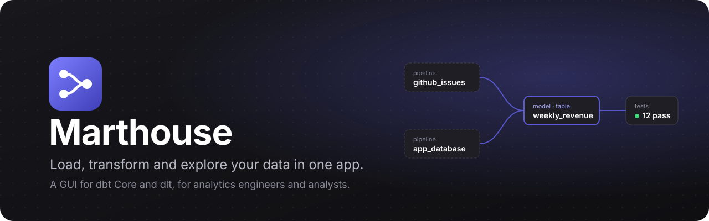
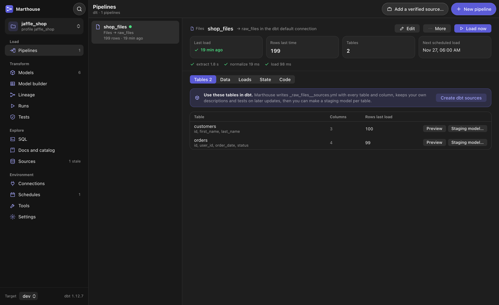
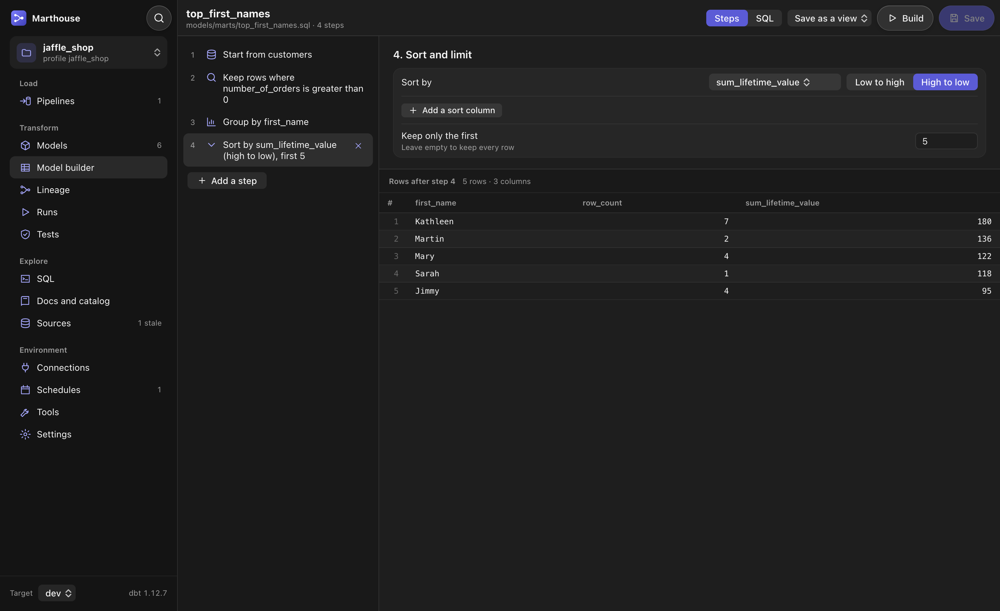
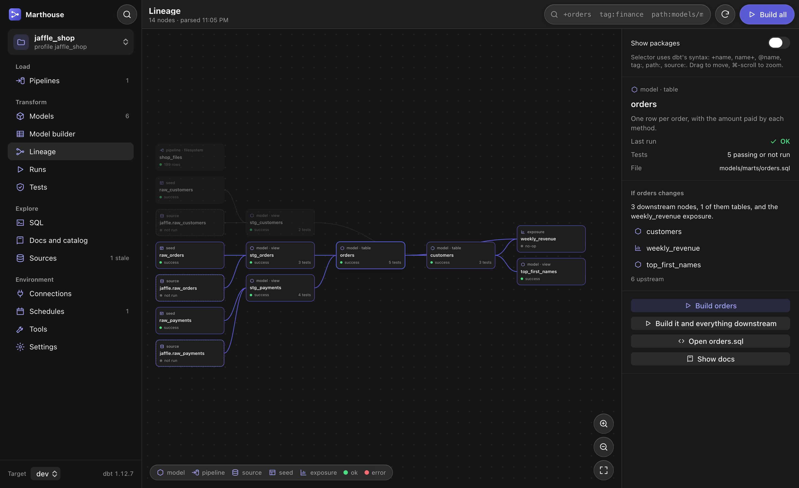
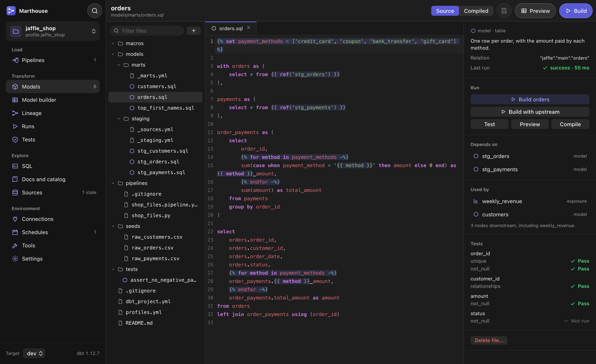
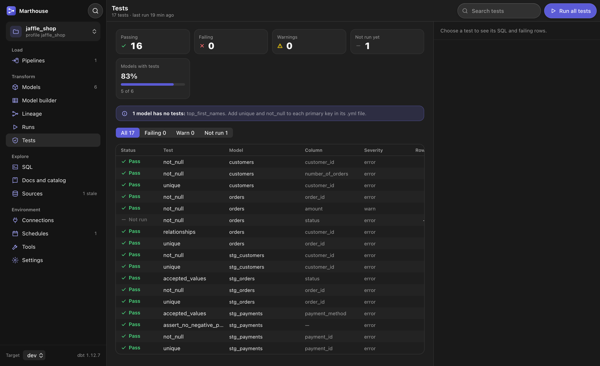
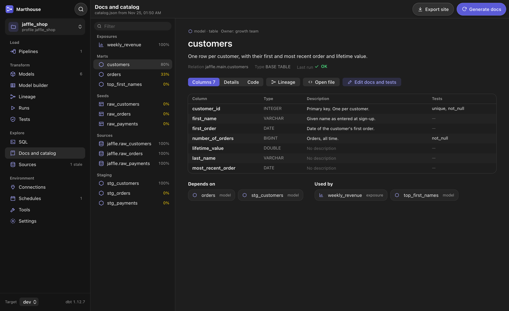
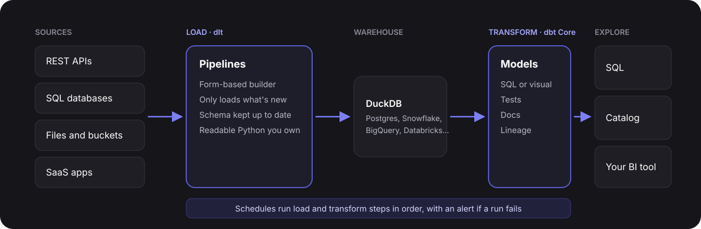

<p align="center">
  
</p>

<p align="center">
  <a href="https://github.com/godalida/marthouse/actions/workflows/ci.yml"></a>
  <a href="LICENSE"></a>
  
  
  
  <a href="CONTRIBUTING.md"></a>
</p>

<h3 align="center">The open-source app for dbt Core and dlt.</h3>

<p align="center">
  Load data from APIs, databases and files. Transform it with tested models. Explore the results.<br>
  All in one app, without living in a terminal, and without giving up the plain files your team reviews in Git.
</p>

<p align="center">
  <a href="#install"><b>Install</b></a> ·
  <a href="#features"><b>Features</b></a> ·
  <a href="#how-it-works"><b>How it works</b></a> ·
  <a href="#run-it-for-a-team"><b>Run it for a team</b></a> ·
  <a href="#faq"><b>FAQ</b></a> ·
  <a href="CONTRIBUTING.md"><b>Contribute</b></a>
</p>

<p align="center">
  
</p>

## Why Marthouse?

dbt and dlt are excellent tools that only speak command line. That's fine for engineers and a wall for everyone else on a data team. Marthouse puts a real interface on them without hiding what they do.

- **Learn the tool by using it.** Every run shows the exact `dbt` or `dlt` command it ran. Every visual step opens as the SQL it writes.
- **No lock-in.** Your project stays a normal dbt project and normal dlt scripts. Close Marthouse and everything still runs from the terminal or CI.
- **Zero setup.** Marthouse finds dbt on your machine (project `.venv`, PATH, pipx, uv, Homebrew, conda) or installs a private copy with [uv](https://docs.astral.sh/uv/).
- **Your data stays put.** Locally, the app only listens on `127.0.0.1` and keeps passwords in your OS keychain, never in files.

### Who it's for

| If you are… | Marthouse gives you… |
|---|---|
| **A data analyst** who knows SQL but not the dbt CLI | A model builder that writes the SQL for you, a scratchpad with `ref()`, and docs you edit like a form |
| **An analytics engineer** | Lineage and impact before you change a model, fast previews, runs you can read, tests at a glance |
| **A BI developer** | One place to see where every dashboard number comes from, back to the API it was loaded from |
| **A small data team** | Loading, transforming and scheduling in one tool, self-hosted, on files you already keep in Git |

## Install

**Requirements:** macOS or Linux, Python 3.11+ and [uv](https://docs.astral.sh/uv/getting-started/installation/). You don't need dbt or dlt; Marthouse installs them if they're missing.

> [!NOTE]
> Marthouse is about to have its first release on PyPI. Until then, install from source.

**From PyPI** (after the first release):

```bash
uvx marthouse            # run it once, without installing
pipx install marthouse   # or install the `marthouse` command
```

**From source** (today):

```bash
git clone https://github.com/godalida/marthouse.git
cd marthouse/backend
uv venv --python 3.12 .venv && uv pip install --python .venv/bin/python -e .
cd ../frontend && npm install && npx vite build
../backend/.venv/bin/marthouse
```

Your browser opens Marthouse, and the first run walks you through it:

1. **Find dbt.** Marthouse looks on your machine, or installs a private copy with the adapters you pick.
2. **Open a project.** Use your own, or try [`examples/jaffle_shop_duckdb`](examples/jaffle_shop_duckdb), which needs no warehouse.
3. **Check the connection.** Marthouse runs `dbt debug` and shows each check.
4. **Build.**

> [!TIP]
> The example project includes a dlt pipeline, `shop_files`, that loads its CSV files into the same DuckDB database dbt uses. Load → Transform → Explore end to end takes a couple of minutes.

## Features

### Load: pipelines with dlt



- Build loaders for **REST APIs, SQL databases, files and buckets**, or any of dltHub's **verified sources**, with forms instead of code.
- **Try request** shows the API's JSON so you can point at the rows you want.
- Loads only what's new, keeps the schema up to date, and shows rows per table, load history and incremental state.
- **Create dbt sources** from a pipeline in one click, and load straight into your dbt connection so one set of credentials serves both tools.
- Every pipeline is a readable Python file in `pipelines/` that runs without Marthouse.

### Transform: models, builder and lineage

<table>
  <tr>
    <td width="50%"></td>
    <td width="50%"></td>
  </tr>
  <tr>
    <td valign="top"><b>Model builder.</b> Start from a model or source, then filter, join, calculate, group and sort. See the rows after every step. It saves a normal dbt model you can open as SQL at any time.</td>
    <td valign="top"><b>Lineage.</b> One graph from pipeline to dashboard. Select a node to see what a change would affect, then build it and everything downstream. Selectors like <code>+orders</code> and <code>tag:finance</code> work in search.</td>
  </tr>
  <tr>
    <td width="50%"></td>
    <td width="50%"></td>
  </tr>
  <tr>
    <td valign="top"><b>Models.</b> A SQL editor with Jinja highlighting, the compiled SQL, row previews with <code>dbt show</code>, and an inspector with refs, tests and the last run.</td>
    <td valign="top"><b>Runs and tests.</b> A live node timeline, logs, and errors explained in plain words. Test coverage at a glance, the failing rows, and one-click re-runs.</td>
  </tr>
</table>

### Explore: SQL, docs and freshness



- **Docs and tests without YAML.** Edit descriptions and tick tests (unique, not null, accepted values, relationships). Marthouse writes the YAML and keeps your comments.
- **SQL scratchpad** with `ref()` and `source()`, query history, CSV download and **Save as model**.
- **Source freshness** against your thresholds, and a **staging-model generator** for any source table.

### And the rest of the job

- **Schedules:** "load, then build, every weekday at 6:00", with a webhook alert when it fails.
- **Connections:** forms that write `profiles.yml`, with secrets in the keychain.
- **⌘K command palette** for every model, screen and command.
- **Light and dark** themes, in a native macOS-style interface.

## How it works

<p align="center">
  
</p>

Marthouse is a FastAPI server and a React app. It runs the real tools as separate processes and reads the files they write: dbt's `manifest.json`, `run_results.json` and `catalog.json`, and dlt's pipeline state. It never reimplements them.

| Works with | Support |
|---|---|
| **dbt Core** | 1.8 and newer, any adapter: DuckDB, Postgres, Snowflake, BigQuery, Redshift, Databricks, SQL Server, Trino |
| **dlt** | 1.x: REST API, SQL database and filesystem sources, plus dltHub verified sources |
| **Destinations** | Anything both tools support. A pipeline can load straight into your dbt connection, so one set of credentials serves both. |
| **dbt Fusion** | Detected and reported. Marthouse works with dbt Core. |

## Run it for a team

Marthouse also runs as a shared web app with accounts, workspaces and roles (viewer, member, admin, owner). Projects are cloned from Git, and dbt and dlt run in a separate worker.

```bash
cp docker/.env.example docker/.env     # set POSTGRES_PASSWORD and MARTHOUSE_SECRET_KEY
docker compose -f docker/docker-compose.yml --env-file docker/.env up --build
```

That starts the web app, a job worker, Postgres and Redis. Put TLS in front and set `MARTHOUSE_COOKIE_SECURE=true`. See [`docker/.env.example`](docker/.env.example) for every setting.

<details>
<summary><b>Configuration reference</b></summary>

| Variable | Default | Purpose |
|---|---|---|
| `MARTHOUSE_MODE` | `local` | `local` (one person, 127.0.0.1 only) or `hosted` (accounts and workspaces) |
| `MARTHOUSE_DATA_DIR` | OS app-data folder | Database, private tool installs, hosted checkouts |
| `MARTHOUSE_DATABASE_URL` | SQLite in the data dir | e.g. `postgresql+psycopg://…` |
| `MARTHOUSE_SECRET_KEY` | generated | Fernet key that encrypts stored secrets (hosted) |
| `MARTHOUSE_USE_QUEUE` | `false` | Hosted: run jobs in the worker through Redis |
| `MARTHOUSE_JOB_TIMEOUT_S` | `3600` | Longest a single job may run. Memory is limited by the worker container (see `docker-compose.yml`). |

</details>

## FAQ

<details>
<summary><b>Is this a replacement for dbt Cloud?</b></summary>

No. It's a free, open-source app for **dbt Core**, the open-source engine. It covers the everyday work (editing, running, testing, lineage, docs, scheduling) and adds loading with dlt. It doesn't include dbt Cloud features like the semantic layer service or dbt Fusion; if Marthouse finds Fusion it says so and keeps using Core.
</details>

<details>
<summary><b>Will it change my project?</b></summary>

Only when you ask it to: saving a model, editing docs or tests, or creating a pipeline writes ordinary files, the same ones you'd write by hand. Everything stays a normal dbt project and normal dlt scripts, ready for code review and CI.
</details>

<details>
<summary><b>Which warehouses does it work with?</b></summary>

Any adapter dbt Core supports: DuckDB, Postgres, Snowflake, BigQuery, Redshift, Databricks, SQL Server, Trino and more. dlt can load into any destination it supports; when a pipeline loads into your dbt connection, Marthouse reuses those credentials.
</details>

<details>
<summary><b>Does my data leave my machine?</b></summary>

Not in local mode. Marthouse runs dbt and dlt on your computer, listens on `127.0.0.1` only, and keeps passwords in the OS keychain. It sends no telemetry of its own, and turns off dbt's and dlt's anonymous usage stats for the jobs it runs.
</details>

<details>
<summary><b>Windows?</b></summary>

Not yet tested. Marthouse is developed on macOS and should work on Linux. Windows support is on the roadmap, and help is welcome.
</details>

## Roadmap

- [x] dbt: find or install, models, lineage, runs, tests, docs, freshness, connections
- [x] dlt: REST API, SQL, files and verified sources; schema, loads and state; dbt source generation
- [x] Visual model builder with live previews
- [x] Schedules with failure alerts
- [x] Hosted mode with workspaces and roles
- [ ] One-line install from PyPI (`uvx marthouse`)
- [ ] Turn hand-written SQL into builder steps
- [ ] dbt projects inside a subfolder of the repository
- [ ] Database migrations for upgrades (Alembic)
- [ ] Windows support and desktop builds
- [ ] More tools: SQLFluff, a dbt packages browser

Have an idea? [Open a feature request](https://github.com/godalida/marthouse/issues/new?template=feature_request.yml).

## Contributing

Contributions are welcome, from typo fixes to whole new tools. Start with [CONTRIBUTING.md](CONTRIBUTING.md). The end-to-end tests use a local DuckDB file, so you don't need a warehouse to work on Marthouse.

- [Report a bug](https://github.com/godalida/marthouse/issues/new?template=bug_report.yml)
- [Suggest a feature](https://github.com/godalida/marthouse/issues/new?template=feature_request.yml)
- [Report a security problem](SECURITY.md) privately
- [Code of conduct](CODE_OF_CONDUCT.md) · [Changelog](CHANGELOG.md)

## Acknowledgements

Marthouse stands on two excellent open-source projects:
- [dbt Core](https://github.com/dbt-labs/dbt-core) by dbt Labs;
- [dlt](https://github.com/dlt-hub/dlt) by dltHub.

It installs them with [uv](https://github.com/astral-sh/uv) from Astral.

"dbt" is a trademark of dbt Labs, Inc. "dlt" and "dltHub" are trademarks of their owner. Marthouse isn't affiliated with or endorsed by either company.

## License

[Apache 2.0](LICENSE). Use it, change it, ship it.
